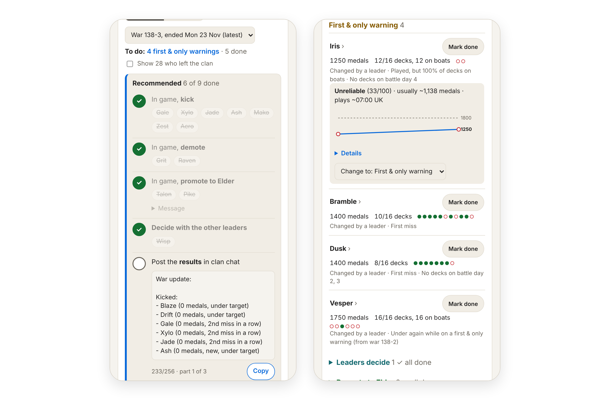

<div align="center">


# War Audit

Clan war tracking and member decisions for Clash Royale, with a Discord bot.

[](https://github.com/Stan2032/CRTrack/actions/workflows/tests.yml)
[](LICENSE)
[](https://workers.cloudflare.com/)

</div>

War Audit follows a clan's river races and tells its leaders who to promote, warn, demote or kick after each war,
with the clan chat messages ready to paste. During battle days it tracks decks, medals and the race live, and its
Discord bot posts the war board, reminders and daily summaries.

<picture>
  <source media="(prefers-color-scheme: dark)" srcset="docs/assets/screenshots-dark.png">
  
</picture>

<sub>Screenshots use real war data with made-up player names.</sub>

## Features

- **After-war decisions:** suggestions from rules each clan sets; kicks, demotions and promotions done in game are
  picked up automatically; copy-ready clan chat messages.
- **Live battle days:** decks played per player, race points and places, each player's chance of reaching the target.
- **History:** every war kept (beyond the API's last 10), joins, leaves, rank changes and decks per battle day.
- **Discord bot:** builds the server's roles and channels, verified account linking, war board, reminders, summaries
  and a weekly digest for leaders.
- **Members' page:** each player sees their own record and forecast.

## How it works

A single [Cloudflare Worker](https://developers.cloudflare.com/workers/) on the free plan serves the site, reads the
official Clash Royale API every 15 minutes (through the [RoyaleAPI proxy](https://docs.royaleapi.com/proxy.html)),
stores history in [D1](https://developers.cloudflare.com/d1/) and answers Discord commands. Plain JavaScript: no
framework, no runtime dependencies, no build step beyond copying shared logic into the Worker.

## Getting started

Follow [docs/SETUP.md](docs/SETUP.md): a Clash Royale API key, a Cloudflare account, leader codes and, optionally,
the Discord bot.

## Development

Requires Node.js 22 or later.

```sh
npm test            # every test suite (the browser checks need Playwright)
npx wrangler dev    # run the Worker and site locally
```

Tests also run on GitHub Actions for every push and pull request.

## Project layout

```
site/      the website: leaders' page, members' page, shared logic and stats
worker/    the Cloudflare Worker: API, scheduled snapshots, history, Discord bot
tests/     node test suites (in-memory SQLite, Playwright for the pages)
samples/   real RoyaleAPI exports used by the tests
docs/      setup, user guide and design notes
```

## Documentation

- [Setup](docs/SETUP.md): everything needed to run it
- [User guide](docs/USER-GUIDE.md): using the site, the bot and the default rules
- [Handoff notes](docs/HANDOFF.md): how it works inside, the maths and the decisions behind it
- [UI guide](docs/UI-GUIDE.md): the usability rules the screens follow

## License

[MIT](LICENSE).

This material is unofficial and is not endorsed by Supercell. For more information see
[Supercell's Fan Content Policy](https://supercell.com/en/fan-content-policy/).
